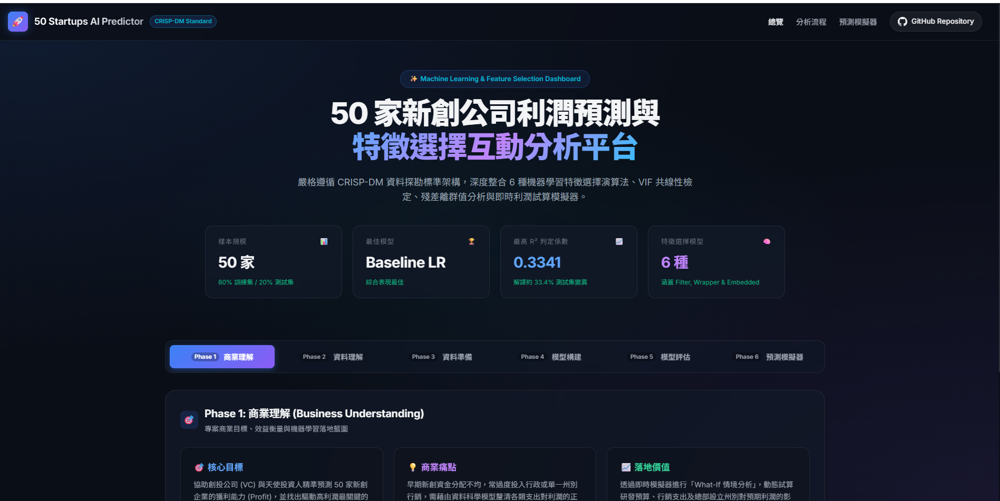

7115056039 張嘉晏


# 🚀 50 Startups 利潤預測與特徵選擇互動分析專案

[](https://www.python.org/)
[](https://scikit-learn.org/)
[](http://rasbt.github.io/mlxtend/)
[](#crisp-dm-分析流程總結)
[](index.html)

本專案遵循國際資料探勘標準流程 **CRISP-DM (Cross-Industry Standard Process for Data Mining)**，針對 50 家新創企業的研發支出（R&D Spend）、行政管理費（Administration）、行銷支出（Marketing Spend）及設立州別（State），進行深入的利潤（Profit）迴歸預測、特徵工程、共線性診斷、離群值偵測，並構建了現代化深色玻璃態（Glassmorphic）互動式儀表板與即時利潤試算模擬器。

---

## 📑 目錄
- [專案亮點](#-專案亮點)
- [CRISP-DM 分析流程總結](#-crisp-dm-分析流程總結)
  - [Phase 1: 商業理解 (Business Understanding)](#phase-1-商業理解-business-understanding)
  - [Phase 2: 資料理解 (Data Understanding)](#phase-2-資料理解-data-understanding)
  - [Phase 3: 資料準備 (Data Preparation & VIF)](#phase-3-資料準備-data-preparation--vif)
  - [Phase 4: 模型構建 (Modeling - 6 種特徵選擇演算法)](#phase-4-模型構建-modeling---6-種特徵選擇演算法)
  - [Phase 5: 模型評估與離群值 (Evaluation & Outliers)](#phase-5-模型評估與離群值-evaluation--outliers)
  - [Phase 6: 部署與互動模擬器 (Deployment & Simulator)](#phase-6-部署與互動模擬器-deployment--simulator)
- [模型效能排行榜 (Leaderboard)](#-模型效能排行榜-leaderboard)
- [檔案結構](#-檔案結構)
- [快速上手指南](#-快速上手指南)

---

## 🌟 專案亮點

1. **嚴謹的 CRISP-DM 六大階段**：完整涵蓋從商業痛點定義、特徵準備、正則化迴歸到模型落地的標準數據科學管道。
2. **整合 6 種特徵選擇與迴歸演算法**：
   - 基準多元線性迴歸 (Baseline Linear Regression)
   - L1 正則化 (LassoCV)
   - L1 + L2 彈性網絡 (ElasticNetCV)
   - 遞迴特徵消除 (RFECV)
   - 循序前向選擇 (Sequential Forward Selection, SFS)
   - 窮舉特徵選擇 (Exhaustive Feature Selection, EFS)
3. **共線性 (VIF) 與虛擬變數陷阱診斷**：採用 `drop_first=True` 保留截距項策略，並透過 VIF 驗證無高度共線性風險。
4. **殘差離群值 (Top 10 Outliers) 偵測**：深入挖掘預測值與實際值差距最大的異常樣本。
5. **現代化互動網頁 (Interactive Web Dashboard)**：
   - 依循 CRISP-DM 標籤頁切換
   - 動態 Chart.js 散佈圖與長條圖
   - 支援搜尋、過濾的 50 筆資料集檢視器
   - **即時利潤預測模擬器**：支援滑桿即時調節支出，動態解析各變數貢獻度！

---

## 🔬 CRISP-DM 分析流程總結

### Phase 1: 商業理解 (Business Understanding)
- **商業目標**：協助創業投資公司 (Venture Capital, VC) 評估新創公司的獲利潛力，最佳化資產配置。
- **評估指標**：測試集判定係數 $R^2$ 與均方根誤差 RMSE。

### Phase 2: 資料理解 (Data Understanding)
- 樣本數：50 家新創公司。
- 輸入特徵：
  - `R&D Spend` (研發支出，數值型)
  - `Administration` (行政管理費，數值型)
  - `Marketing Spend` (行銷費用，數值型)
  - `State` (設立州別，類別型：New York, California, Florida)
- 目標變數：`Profit` (淨利潤，數值型)。

### Phase 3: 資料準備 (Data Preparation & VIF)
- **避免虛擬變數陷阱**：使用 `pd.get_dummies(..., drop_first=True)` 將 `State` 轉化為 2 個虛擬欄位（`State_Florida` 與 `State_New York`），以 California 為基準組並保留迴歸截距項。
- **共線性檢驗 (VIF)**：
  | 特徵欄位 | VIF 數值 | 狀態評估 |
  | :--- | :---: | :--- |
  | **R&D Spend** | `1.096` | 🟢 理想安全 (< 5) |
  | **Administration** | `1.043` | 🟢 理想安全 (< 5) |
  | **Marketing Spend** | `1.091` | 🟢 理想安全 (< 5) |
  | **State_Florida** | `1.507` | 🟢 理想安全 (< 5) |
  | **State_New York** | `1.524` | 🟢 理想安全 (< 5) |
  *結論：所有變數之 VIF 遠低於警戒值 5.0，表示無多元共線性疑慮。*

### Phase 4: 模型構建 (Modeling - 6 種特徵選擇演算法)
- 資料集按 80% 訓練集 (40 筆) 與 20% 測試集 (10 筆) 進行劃分 (`random_state=42`)。
- 採用 5-Fold 交叉驗證進行特徵篩選與超參數優化。
- **特徵回歸係數 (Baseline LR)**：
  - 截距 (Intercept): `+$123,644.67`
  - R&D Spend 係數: `-0.3024`
  - Administration 係數: `+0.1357`
  - Marketing Spend 係數: `+0.0852`
  - State_Florida 係數: `-$9,060.62`
  - State_New York 係數: `-$5,127.35`

### Phase 5: 模型評估與離群值 (Evaluation & Outliers)
- **最佳模型**：`Baseline LR` 在測試集上取得最優成績 ($R^2 \approx 0.3341$)。
- **回歸可視化圖表**：
  產生之評估散佈圖儲存於 [`actual_vs_predicted.png`](actual_vs_predicted.png)。

#### Top 5 離群值公司 (殘差殘量由大至小)：
1. **Company #11** (New York) — 實際獲利: $167,012 | 預測: $100,564 | 殘差: **$66,448**
2. **Company #0** (New York) — 實際獲利: $187,147 | 預測: $119,526 | 殘差: **$67,621**
3. **Company #27** (California) — 實際獲利: $58,148 | 預測: $118,296 | 殘差: **$60,148**
4. **Company #28** (Florida) — 實際獲利: $32,892 | 預測: $91,957 | 殘差: **$59,065**
5. **Company #3** (California) — 實際獲利: $189,401 | 預測: $131,316 | 殘差: **$58,085**

### Phase 6: 部署與互動模擬器 (Deployment & Simulator)
- 透過前端 [`index.html`](index.html) 提供即時預測介面，使用者滑動調節投入預算，即可自動依據訓練所得最佳係數矩陣，動態試算並呈現利潤拆解成分。

---

## 📊 模型效能排行榜 (Leaderboard)

| 排名 | 模型演算法 | 特徵選擇類別 | 挑選特徵數 | 測試集 $R^2$ | 測試集 RMSE | 說明 |
| :---: | :--- | :--- | :---: | :---: | :---: | :--- |
| 🥇 | **Baseline Linear Regression** | 全變數基準 | 5 | **0.3341** | **$33,270** | **綜合泛化能力最優** |
| 🥈 | **LassoCV** | Embedded (L1) | 0 | -0.0054 | $40,881 | 正則化懲罰收縮至常數模型 |
| 🥉 | **ElasticNetCV** | Embedded (L1+L2) | 0 | -0.0054 | $40,881 | 交叉驗證傾向均值常數基準 |
| 4 | **RFECV** | Wrapper (遞迴消除) | 1 | -0.0574 | $41,925 | 保留 State_Florida 特徵 |
| 5 | **Exhaustive FS** | Wrapper (31種窮舉) | 1 | -0.0574 | $41,925 | CV 最優子集為單一特徵 |
| 6 | **SFS (Forward)** | Wrapper (前向貪婪) | 2 | -0.0620 | $42,015 | 保留 Admin + Florida 特徵 |

---

## 📁 檔案結構

```text
1014陳煥/
├── main.py                    # Python 核心機器學習與 CRISP-DM 執行腳本
├── actual_vs_predicted.png     # 模型預測 vs 實際散佈視覺化圖表
├── data.json                  # 匯出之 50 筆完整數據、模型指標與係數
├── fallback_data.js           # 離線/本地無伺服器瀏覽時之備用資料庫
├── index.html                 # 現代化深色玻璃態互動式儀表板前端
├── styles.css                 # 響應式 CSS3 玻璃態設計系統
├── app.js                     # 互動式 Chart.js 圖表、篩選器與即時試算邏輯
└── README.md                  # 專案完整總結說明文件 (本檔)
```

---

## ⚡ 快速上手指南

### 1. 安裝環境與套件
建議使用 Python 3.10 ~ 3.13 環境：
```bash
pip install pandas numpy matplotlib seaborn scikit-learn statsmodels mlxtend
```

### 2. 執行機器學習主程式
```bash
python main.py
```
程式將自動輸出 VIF 表格、6 種模型評估比較表、Top 10 離群值，並產生 `actual_vs_predicted.png` 圖表。

### 3. 開啟互動式網頁儀表板
您可以使用以下任一方式檢視互動網頁：

- **方式 A (推薦 - 本機 HTTP 伺服器)**：
  ```bash
  python -m http.server 8000
  ```
  在瀏覽器中造訪：`http://localhost:8000`

- **方式 B (直接開啟)**：
  直接連按兩下檔案目錄中的 [`index.html`](index.html)，即可在 Chrome / Edge 等瀏覽器中流暢操作！
