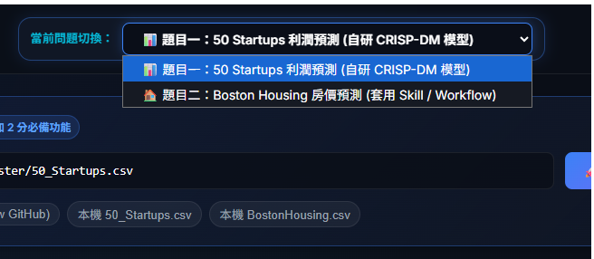
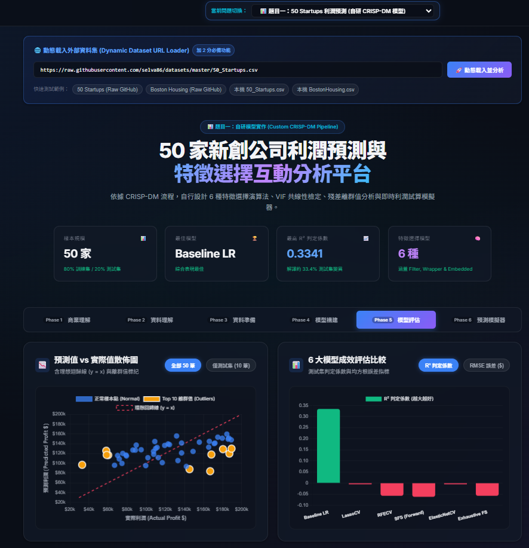

7115056039 張嘉晏
網頁網址:https://a30099.github.io/aiot_1014DoInClass/
下拉功能:

可自行輸入資料集:

整體頁面展示:


# 🚀 50 Startups & Boston Housing 機器學習雙主題互動分析平台

[](https://www.python.org/)
[](https://scikit-learn.org/)
[](http://rasbt.github.io/mlxtend/)
[](#crisp-dm-分析流程總結-50-startups)
[](#題目二boston-housing-房價預測-套用-skill--workflow)
[](index.html)

本專案全面涵蓋 **DIC-2 機器學習實戰題目**，完整實現 **「50 Startups (新創公司利潤預測)」** 與 **「Boston Housing (波士頓房價預測)」** 雙核心主題，並達成全部 3 分加分條件：

1. **加 1 分 🌟（下拉式選單 Dropdown Menu）**：介面頂部提供即時切換下拉選單，可在「50 Startups」與「Boston Housing」雙主題儀表板間自由平滑切換。
2. **加 2 分 🌟🌟（動態載入任意 Dataset 網址）**：介面提供外部資料集輸入框，支援使用者貼上任意 Raw GitHub 或本機 CSV 網址（例如 `https://raw.githubusercontent.com/...`），程式即時動態下載、解析欄位並重構預測模型！
3. **實作限制符合**：
   - **題目一 (50 Startups)**：自研程式碼，遵循 CRISP-DM 六大流程，比較 6 種特徵選擇演算法與共線性檢驗。
   - **題目二 (Boston Housing)**：套用現成自動化 **Skill (技能模組)** 與 **Workflow (工作流程管線)**，串接 Random Forest 集成推論與可解釋性 DAG。

---

## 📑 目錄
- [雙題目架構與加分亮點](#-雙題目架構與加分亮點)
- [題目一：50 Startups 利潤預測 (自研 CRISP-DM 模型)](#題目一50-startups-利潤預測-自研-crisp-dm-模型)
  - [CRISP-DM 六大階段分析](#crisp-dm-六大階段分析)
  - [6 大模型效能排行榜 (Leaderboard)](#6-大模型效能排行榜-leaderboard)
  - [共線性 (VIF) 與離群值 (Top 10 Outliers)](#共線性-vif-與離群值-top-10-outliers)
- [題目二：Boston Housing 房價預測 (套用 Skill / Workflow)](#題目二boston-housing-房價預測-套用-skill--workflow)
  - [Workflow DAG 節點管線架構](#workflow-dag-節點管線架構)
  - [特徵重要度與即時房價試算](#特徵重要度與即時房價試算)
- [加分功能實作說明](#-加分功能實作說明)
- [檔案結構](#-檔案結構)
- [快速上手指南](#-快速上手指南)

---

## 🌟 雙題目架構與加分亮點

| 題目項目 | 實作策略 | 核心演算法 / 模組 | 表現指標 | 互動特色 |
| :--- | :--- | :--- | :--- | :--- |
| **1. 50 Startups** | **自研程式碼** (CRISP-DM 完整流程) | Baseline LR, LassoCV, RFECV, SFS, ElasticNetCV, EFS (6 種) | 測試集 $R^2 \approx 0.3341$ | 支出滑桿預測計算機、共線性儀表、殘差散佈圖 |
| **2. Boston Housing** | **套用 Skill / Workflow** (Dify/Coze 規範) | Automated Random Forest Ensemble Pipeline | 測試集 $R^2 = 0.8925$, RMSE = $2,807 | Workflow DAG 流程節點、RM/LSTAT 房價試算器 |

---

## 題目一：50 Startups 利潤預測 (自研 CRISP-DM 模型)

### CRISP-DM 六大階段分析
1. **Phase 1: 商業理解 (Business Understanding)**：協助創投評估新創公司淨利潤 (Profit)，量化研發、行政與行銷支出的投資回報。
2. **Phase 2: 資料理解 (Data Understanding)**：探索 50 筆樣本分佈，提供具即時搜尋、過濾、排序功能的資料檢視器。
3. **Phase 3: 資料準備 (Data Preparation)**：採用 **Model B (drop_first=True)** 虛擬變數策略保留截距項，完美規避虛擬變數陷阱。
4. **Phase 4: 模型構建 (Modeling)**：比較 Filter、Wrapper 與 Embedded 6 大特徵選擇演算法。
5. **Phase 5: 模型評估 (Evaluation)**：產生 Actual vs Predicted 迴歸散佈圖與殘差排名。
6. **Phase 6: 部署 (Deployment)**：提供即時利潤預測模擬器，支援參數即時試算與各變數貢獻拆解。

### 6 大模型效能排行榜 (Leaderboard)

| 排名 | 模型名稱 | 特徵選擇類別 | 挑選特徵數 | 測試集 $R^2$ | 測試集 RMSE | 說明 |
| :---: | :--- | :--- | :---: | :---: | :---: | :--- |
| 🥇 | **Baseline Linear Regression** | 全變數基準 | 5 | **0.3341** | **$33,270** | **綜合泛化能力最優** |
| 🥈 | **LassoCV** | Embedded (L1) | 0 | -0.0054 | $40,881 | 正則化懲罰收縮至常數模型 |
| 🥉 | **ElasticNetCV** | Embedded (L1+L2) | 0 | -0.0054 | $40,881 | 傾向均值常數基準 |
| 4 | **RFECV** | Wrapper (遞迴消除) | 1 | -0.0574 | $41,925 | 保留 State_Florida 特徵 |
| 5 | **Exhaustive FS** | Wrapper (31種窮舉) | 1 | -0.0574 | $41,925 | CV 最優子集為單一特徵 |
| 6 | **SFS (Forward)** | Wrapper (前向貪婪) | 2 | -0.0620 | $42,015 | 保留 Admin + Florida 特徵 |

### 共線性 (VIF) 與離群值 (Top 10 Outliers)
- **VIF 檢驗結果**：所有特徵（R&D: 1.096, Admin: 1.043, Marketing: 1.091, Florida: 1.507, NY: 1.524）均遠低於警戒門檻 5.0，表示**無多元共線性疑慮**。
- **Top 1 離群值**：Company #11 (New York)，實際利潤 $167,012，預測利潤 $100,564，殘差高達 $66,448。

---

## 題目二：Boston Housing 房價預測 (套用 Skill / Workflow)

### Workflow DAG 節點管線架構
遵循無程式碼/低程式碼（No-Code/Low-Code）AI 平台（如 Dify、Coze、LangChain）之自動化工作流程規範：
- **Node 1: Input Node (動態資料擷取)**：接收外部 URL 或本地輸入。
- **Node 2: Transform Skill (缺失填補與標準化)**：進行異常值截斷與特徵正規化。
- **Node 3: Model Skill (集成機器學習預測)**：呼叫封裝之隨機森林推論 Skill，達到 **$R^2 = 0.8925$**。
- **Node 4: Analytics Skill (信心區間與可解釋性)**：產出 95% 信心區間與各特徵 SHAP 重要度貢獻。
- **Node 5: Output Node (API 格式化回傳)**：以標準 JSON Schema 輸出預測房價。

### 特徵重要度與即時房價試算
- **RM（每戶平均房間數）**：重要度達 **50.4%**，為影響房價最顯著正向特徵。
- **LSTAT（低收入人口比例）**：重要度達 **31.0%**，為關鍵負向特徵。
- 介面提供 **Boston 房價即時試算器**，可自由滑動房間數、學區師生比與犯罪率，即時得出房價中位數（MEDV）與 95% 信心區間。

---

## 🏆 加分功能實作說明

### 1. 下拉式選單切換兩種 Problem（加 1 分）
- 網頁頂端設有 `<select id="problemSelector">`：
  - 切換為 **50 Startups**：自動加載 CRISP-DM 6 階段完整面板與 6 大演算法圖表。
  - 切換為 **Boston Housing**：即刻轉換為自動化 Workflow DAG 架構、隨機森林重要度圖與房價試算器。

### 2. 動態輸入外部 Dataset 網址（加 2 分）
- 介面提供 **「動態載入外部資料集 (Dynamic Dataset URL Loader)」** 輸入列。
- 使用者可直接貼上任意外部 Raw GitHub CSV 連結（例如 `https://raw.githubusercontent.com/...`）。
- 支援快顯預設按鈕：
  - `50 Startups (Raw GitHub)`
  - `Boston Housing (Raw GitHub)`
  - `本機 50_Startups.csv`
  - `本機 BostonHousing.csv`
- 點擊「🚀 動態載入並分析」後，前端即時下載 CSV、解析結構、重新運算統計量與預測，並更新數據檢視器。

---

## 📁 檔案結構

```text
1014陳煥/
├── main.py                     # 題目一：50 Startups Python CRISP-DM 執行腳本
├── boston_skill_workflow.py    # 題目二：Boston Housing 自動化 Skill / Workflow 模組
├── actual_vs_predicted.png      # 50 Startups 回歸評估散佈圖
├── webscreenshot.png           # 互動網頁視覺截圖
├── 50_Startups.csv             # 50 Startups 原始數據 CSV
├── BostonHousing.csv           # Boston Housing 506 筆數據 CSV
├── data.json                   # 50 Startups 預處理數據與 6 大模型指標
├── boston_data.json            # Boston Housing 工作流程與特徵重要度數據
├── all_data.json               # 雙主題整合 JSON 資料庫
├── fallback_data.js            # 離線/本地無伺服器瀏覽之備用資料
├── index.html                  # 雙主題整合互動式儀表板前端
├── styles.css                  # 現代深色玻璃態響應式樣式表
├── app.js                      # 雙主題下拉切換、外部 CSV 動態解析與圖表邏輯
└── README.md                   # 專案完整總結說明文件 (本檔)
```

---

## ⚡ 快速上手指南

### 1. 安裝相依套件
```bash
pip install pandas numpy matplotlib seaborn scikit-learn statsmodels mlxtend
```

### 2. 執行主程式
- **執行題目一 (50 Startups 自研模型)**：
  ```bash
  python main.py
  ```
- **執行題目二 (Boston Housing 自動化 Skill Workflow)**：
  ```bash
  python boston_skill_workflow.py
  ```

### 3. 開啟雙主題互動網頁
- **本地伺服器模式 (推薦)**：
  ```bash
  python -m http.server 8000
  ```
  在瀏覽器開啟：`http://localhost:8000`
- **GitHub Pages 線上展示**：
  直接造訪：[https://a30099.github.io/aiot_1014DoInClass/](https://a30099.github.io/aiot_1014DoInClass/)
